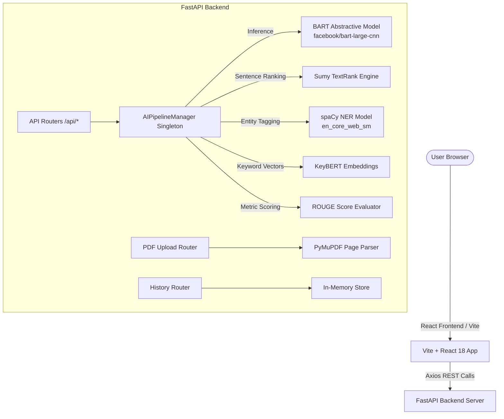

# Summora — Production AI Text Summarizer Platform

**Summora** is a complete full-stack web application for multi-modal text summarization, comparative NLP analysis, named entity recognition, keyword extraction, and ROUGE evaluation metrics.

---

## 🌟 Key Features

1. **Abstractive Summarization (BART)**
   - Powered by Hugging Face `facebook/bart-large-cnn`.
   - Generates novel, coherent, human-like summaries.
   - Customizable summary presets (`short`, `medium`, `long`) and max token length sliders.

2. **Extractive Summarization (TextRank)**
   - Graph-based sentence ranking via Sumy algorithm.
   - Preserves exact pivotal sentences from original source text.

3. **PDF Document Reader**
   - Drag-and-drop PDF parser utilizing PyMuPDF (`fitz`).
   - Extracts page-by-page text content instantly for summarization.

4. **spaCy Named Entity Recognition (NER)**
   - Highlights and categorizes entities: Persons, Organizations, Geopolitical Entities, Locations, Dates, Money, Events, and Works of Art.

5. **KeyBERT Keyword Extraction**
   - Extracts top contextual keyphrases using BERT embeddings and TF-IDF similarity.

6. **ROUGE & Statistical Metrics**
   - Calculates **ROUGE-1**, **ROUGE-2**, and **ROUGE-L** F1 precision scores.
   - Tracks word counts, character counts, reading time reduction, and compression ratios.

7. **Extractive vs Abstractive Comparison Lab**
   - Dual-view workspace comparing both summarization methods side-by-side with pros & cons analysis cards.

8. **Summary History Archive**
   - In-memory history manager with instant search, detailed modal view, and record deletion.

9. **Export Capabilities**
   - One-click downloads as `.txt` files or formatted printable `.pdf` reports.

10. **Modern UI / UX Aesthetics**
    - Glassmorphism UI with Tailwind CSS.
    - Dark & Light mode theme toggle.
    - Fully responsive layout with smooth transitions and zero placeholder code.

---

## 🏗️ System Architecture



---

## 📁 Project Structure

```
text-summarizer/
├── backend/
│   ├── app/
│   │   ├── ai/
│   │   │   ├── __init__.py
│   │   │   ├── abstractive.py       # BART Transformer model loader & inference
│   │   │   ├── extractive.py        # TextRank & Sumy graph summarizer
│   │   │   ├── keywords.py          # KeyBERT keyphrase extractor
│   │   │   ├── metrics.py           # ROUGE scores & reading stats
│   │   │   ├── ner.py               # spaCy Named Entity Recognizer
│   │   │   └── pipeline.py          # Unified AIPipelineManager singleton
│   │   ├── models/
│   │   │   ├── __init__.py
│   │   │   └── history.py           # History store manager
│   │   ├── routers/
│   │   │   ├── __init__.py
│   │   │   ├── history.py           # GET/DELETE /api/history
│   │   │   ├── nlp.py               # POST /api/keywords, /api/entities, /api/evaluate
│   │   │   ├── pdf.py               # POST /api/upload-pdf
│   │   │   └── summarize.py         # POST /api/summarize, /api/extractive
│   │   ├── schemas/
│   │   │   ├── __init__.py
│   │   │   └── requests.py          # Pydantic request/response schemas
│   │   ├── utils/
│   │   │   ├── __init__.py
│   │   │   ├── pdf_parser.py        # PyMuPDF text reader
│   │   │   └── text_cleaner.py      # Text preprocessor & reading time calculator
│   │   ├── __init__.py
│   │   └── main.py                  # FastAPI server application
│   ├── .env.example
│   ├── .gitignore
│   ├── main.py                      # Root entrypoint runner
│   ├── Procfile                     # Deployment process config
│   ├── render.yaml                  # Render deployment configuration
│   └── requirements.txt             # Python dependencies
├── frontend/
│   ├── src/
│   │   ├── assets/
│   │   ├── components/
│   │   │   ├── EntityHighlighter.jsx# spaCy NER entity badges
│   │   │   ├── ExportButtons.jsx    # TXT & PDF download triggers
│   │   │   ├── FileUpload.jsx       # Drag-and-drop PDF uploader
│   │   │   ├── Footer.jsx           # Platform footer
│   │   │   ├── KeywordBadges.jsx    # KeyBERT badges with copy
│   │   │   ├── Navbar.jsx           # Glass navbar & theme toggle
│   │   │   ├── RougeProgress.jsx    # ROUGE-1/2/L progress bars
│   │   │   └── TextStatsCard.jsx    # Word count & reading stats
│   │   ├── pages/
│   │   │   ├── Comparison.jsx       # Side-by-side comparison lab
│   │   │   ├── History.jsx          # Saved summary history archive
│   │   │   ├── Home.jsx             # Landing page
│   │   │   └── Summarizer.jsx       # Main interactive app workspace
│   │   ├── services/
│   │   │   └── api.js               # Axios REST API client
│   │   ├── utils/
│   │   │   └── exportUtils.js       # TXT and PDF export utility
│   │   ├── App.jsx                  # React Router root
│   │   ├── index.css                # Tailwind directives & glassmorphism
│   │   └── main.jsx                 # React DOM mount point
│   ├── index.html
│   ├── package.json
│   ├── postcss.config.js
│   ├── tailwind.config.js
│   ├── vercel.json                  # Vercel deployment rewrite rules
│   └── vite.config.js
└── README.md
```

---

## 🛠️ Technology Stack

| Layer | Technologies |
| :--- | :--- |
| **Frontend** | React 18, Vite, Tailwind CSS, Axios, React Router DOM, React Icons |
| **Backend** | FastAPI, Uvicorn, Pydantic, Python 3.10+ |
| **AI / NLP** | PyTorch, Hugging Face Transformers (`facebook/bart-large-cnn`), Sumy (TextRank), spaCy (`en_core_web_sm`), KeyBERT, ROUGE-Score, NLTK |
| **Document Processing** | PyMuPDF (`fitz`) |
| **Deployment** | Frontend → Vercel \| Backend → Render |

---

## 🚀 Quickstart & Local Installation

### 1. Clone & Setup Backend

```bash
cd backend

# Create virtual environment
python -m venv venv

# Activate virtual environment
# Windows:
venv\Scripts\activate
# Linux/macOS:
source venv/bin/activate

# Install dependencies
pip install -r requirements.txt
python -m spacy download en_core_web_sm

# Start FastAPI server
python main.py
```
FastAPI server starts at `http://localhost:8000`. Interactive API Docs are available at `http://localhost:8000/docs`.

### 2. Setup & Launch Frontend

In a new terminal window:
```bash
cd frontend

# Install Node modules
npm install

# Launch Vite development server
npm run dev
```
Open `http://localhost:5173` in your browser.

---

## 📡 API Reference

### 1. Summarization
- `POST /api/summarize` — Generates abstractive summary using BART.
- `POST /api/extractive` — Generates extractive summary using TextRank.

### 2. Document Processing
- `POST /api/upload-pdf` — Accepts multipart PDF file upload and returns extracted text.

### 3. NLP Analytics
- `POST /api/keywords` — Extracts keyphrases via KeyBERT.
- `POST /api/entities` — Performs spaCy Named Entity Recognition.
- `POST /api/evaluate` — Calculates ROUGE-1, ROUGE-2, ROUGE-L, and reading statistics.

### 4. History Management
- `GET /api/history` — Returns all saved summary records.
- `DELETE /api/history/{id}` — Removes a specific summary item by ID.

---

## ☁️ Deployment Instructions

### Deploy Frontend to Vercel
1. Push project to GitHub.
2. Connect repository to [Vercel](https://vercel.com).
3. Set **Root Directory** to `frontend`.
4. Build command: `npm run build`, Output directory: `dist`.
5. Environment variables: `VITE_API_URL=https://your-backend.onrender.com/api`.

### Deploy Backend to Render
1. Create a new **Web Service** on [Render](https://render.com).
2. Connect repository and set **Root Directory** to `backend`.
3. Build Command: `pip install -r requirements.txt && python -m spacy download en_core_web_sm`.
4. Start Command: `uvicorn app.main:app --host 0.0.0.0 --port $PORT`.
